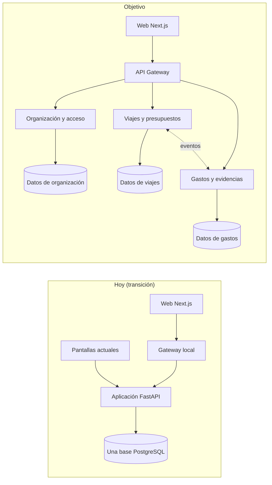

# Arquitectura objetivo y mapa de acoplamientos

Complementa `docs/adr/0001-arquitectura-objetivo.md`. Aquí está el mapa de dueños de datos (la etapa M0 del plan fullstack): qué tabla es de quién, qué cruza hoy de un dominio a otro y qué hay que cortar para separar servicios.

Datos de la revisión del 12 de noviembre de 2026 sobre la rama `dev`.

## Dónde estamos y hacia dónde vamos

## Dueños de cada tabla

| Dominio | Tablas |
|---|---|
| **Organización y acceso** | `usuarios`, `sesiones`, `proyectos`, `proyecto_miembros` |
| **Viajes y presupuestos** (reto 1) | `viajeros`, `membresias`, `solicitudes`, `opciones`, `decisiones`, `elecciones`, `viajes`, `observaciones`, `historial_ruta`, `busquedas`, `consultas_buscador` |
| **Gastos y evidencias** (reto 2) | `documentos`, `gastos`, `vinculos_telegram`, `telegram_mensajes` |

Tablas sin dueño claro, que hay que decidir antes de separar:

| Tabla | Problema | Propuesta |
|---|---|---|
| `reglas` | Mezcla reglas de aerolíneas y supuestos de viaje (Viajes) con tasas de cambio y tolerancia del presupuesto (Gastos) | Partirla: reglas de viaje en Viajes; tasas y tolerancias en Gastos |
| `eventos` | Bitácora que escriben todos | Cada servicio con su propia auditoría; la vista transversal se arma por composición |
| `errores` | Registro técnico | Cada servicio el suyo |
| `llamadas_modelo` | La usan la lectura de recibos (Gastos) y el agente (Viajes) | Cada servicio registra sus llamadas |
| `fichas_rag`, `indice_rag`, `asistente_consultas` | El asistente lee de los tres dominios | Capa de lectura propia que consulta por contrato, no por tablas |
| `usuarios.telegram_chat_id`, `usuarios.viaje_activo_id` | Datos de Gastos guardados en la tabla de Organización | Mover a Gastos |

## Lo que cruza hoy de un dominio a otro

| Cruce | Cantidad | Ejemplo |
|---|---|---|
| Claves foráneas entre dominios | 16 de 29 | `gastos.viaje_id` → `viajes`; `viajes.usuario_id` → `usuarios` |
| Consultas que deciden algo | 4 | `viajes.lista` suma `gastos` para resolver a qué viaje va un gasto |
| Consultas de pantallas | 11 | Inicio, Mi cuenta, tablero de proyecto, contadores del menú |
| Consultas analíticas | 8 | Las vistas `v_h_*` y el monitoreo |
| Escrituras que tocan dos dominios | 8 | Crear una cuenta crea también su perfil de viajero; aprobar un viaje avisa por Telegram |
| Ciclos de dependencia entre módulos | 2 | `viajes` ⇄ `telegram`; `viajes` → `telegram` → `gastos` → `validacion` → `viajes` |

## Los cinco cortes más difíciles, en orden

| # | Acoplamiento | Por qué es difícil | Cómo se corta |
|---|---|---|---|
| 1 | **Control del presupuesto**: Gastos decide sumando su propia tabla contra el límite de Viajes | Sin bloqueo y con confirmación sentencia a sentencia: dos aprobaciones simultáneas pueden pasar el límite | Libro de reservas y consumos dueño de Viajes; Gastos pide autorización; saga con estados persistidos |
| 2 | **Asignar el viaje a un gasto** | Se resuelve en línea con el estado de Viajes, el viaje activo guardado en Organización y los permisos; lo usan la web y Telegram | Viajes expone «viajes autorizados de la persona»; Gastos guarda la referencia y la valida por contrato |
| 3 | **Permisos metidos en el SQL** de cada dominio | La subconsulta a `proyecto_miembros` va dentro de las consultas de Viajes y Gastos | Organización publica el alcance de la persona; cada servicio lo aplica a sus datos |
| 4 | **Identidad en dos sentidos** entre cuenta y viajero | Crear una cuenta crea un viajero; el titular se busca de viajero a cuenta | El viajero pasa a ser de Viajes, con referencia a la persona |
| 5 | **Ejecución del presupuesto en todas las pantallas** | Inicio, tablero, detalle, Telegram y monitoreo calculan lo gastado | Proyección con versión y fecha, alimentada por eventos; nunca autoriza un gasto |

## Transacciones y dinero

- El motor confirma cada sentencia por separado y cada ayudante de `app/db.py` abre su propia conexión. Nueve operaciones de negocio necesitan varias sentencias en una transacción (registrar un gasto, aprobarlo contra el presupuesto, decidir un viaje, cambiar su estado, vincular Telegram, entre otras). El frente `integridad` introduce la transacción real en la aprobación.
- Los importes están en coma flotante en diez tablas y se convierten a `float` al leer. La API v1 los entrega como cadenas con dos decimales; el cambio de tipo en la base se hace antes de separar servicios.

## Lo que ya facilita la migración

- Rutas divididas por área (`app/rutas/`), cargadas solas; la API v1 en su propio prefijo y módulos (`app/rutas/v1_*.py`).
- Servicios por dominio en `app/servicios/`; cada servicio puede declarar sus propias tablas.
- Configuración por variables, con fallo cerrado fuera de local.
- Imagen de contenedor portable y entorno local con PostgreSQL, gateway y web (`docker-compose.yml`).
- Identificador de petición en cada respuesta y en cada error.
- Contrato escrito (`contracts/api-v1.md`) y pruebas de permisos por rol.

## Infraestructura: hoy frente al objetivo

| Pieza | Hoy | Objetivo | Anillo |
|---|---|---|---|
| Web | Pantallas servidas por el backend | Next.js en `web/` | 1 |
| Entrada | URL de función pública | API Gateway con rutas por servicio | 0 en local, 4 en la nube |
| Cómputo | Una función con una imagen | Una función o contenedor por servicio, con su secreto | 3 y 4 |
| Datos | Una base con claves cruzadas | Esquema y luego base por servicio, con credencial propia | 2 y 3 |
| Archivos | Un bucket con clave de servicio | Bucket privado de Gastos con credencial acotada | 3 |
| Mensajería | Solo avisos por correo | Tema por evento, cola por consumidor, cola de fallos y relay del outbox | 3 |
| Migraciones | Idempotentes, sin versión | Versionadas por servicio | 2 |
| Integración continua | Linter y pruebas en SQLite | Además PostgreSQL aislado, web y un trabajo por servicio | 1 a 3 |
| Entorno local | PostgreSQL, aplicación, web y gateway en Compose | Un contenedor por servicio | 3 |
