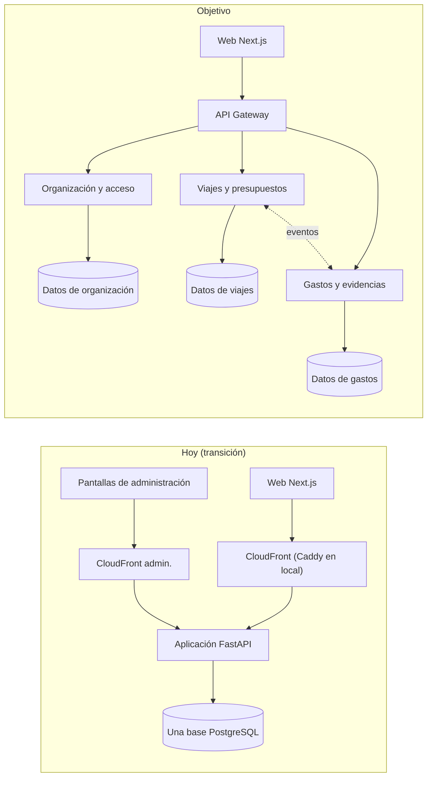

# Arquitectura objetivo y mapa de acoplamientos

Complementa `docs/adr/0001-arquitectura-objetivo.md`. Aquí está el mapa de dueños de datos: qué tabla es de quién, qué cruza de un dominio a otro y qué hay que cortar para separar servicios.

> **Fotografía con fecha.** El análisis de acoplamientos es de la revisión del 12 de noviembre de 2026 sobre la rama `dev`. El 13 de noviembre se pusieron al día la tabla de dueños (tablas nuevas), el conteo de claves foráneas, las transacciones y la infraestructura; los conteos de consultas y escrituras que cruzan dominios siguen siendo los del 12.

## Dónde estamos y hacia dónde vamos

## Dueños de cada tabla

| Dominio | Tablas |
|---|---|
| **Organización y acceso** | `usuarios`, `sesiones`, `proyectos`, `proyecto_miembros`, `cargos` |
| **Viajes y presupuestos** (reto 1) | `viajeros`, `membresias`, `solicitudes`, `opciones`, `decisiones`, `elecciones`, `viajes`, `tramos_vuelo`, `envios_cotizacion`, `observaciones`, `historial_ruta`, `busquedas`, `consultas_buscador`; datos de referencia del buscador: `aeropuertos_mundo`, `lugares`, `paises`, `aeropuertos_google` |
| **Gastos y evidencias** (reto 2) | `documentos`, `gastos`, `envios_soporte`, `justificaciones`, `vinculos_telegram`, `telegram_mensajes` |

Tablas sin dueño claro, que hay que decidir antes de separar:

| Tabla | Problema | Propuesta |
|---|---|---|
| `reglas` | Mezcla reglas de aerolíneas y supuestos de viaje (Viajes) con tasas de cambio y tolerancia del presupuesto (Gastos) | Partirla: reglas de viaje en Viajes; tasas y tolerancias en Gastos |
| `eventos` | Bitácora que escriben todos | Cada servicio con su propia auditoría; la vista transversal se arma por composición |
| `errores` | Registro técnico | Cada servicio el suyo |
| `llamadas_modelo` | La usan la lectura de recibos (Gastos) y el agente (Viajes) | Cada servicio registra sus llamadas |
| `fichas_rag`, `indice_rag`, `asistente_consultas` (y `asistente_dictados`, con el asistente para colaborador y gestor) | El asistente lee de los tres dominios | Capa de lectura propia que consulta por contrato, no por tablas |
| `cargas_datos` | Registro de las cargas de datos de referencia (hoy, los del buscador) | Con los datos de referencia, en Viajes |
| `usuarios.telegram_chat_id`, `usuarios.viaje_activo_id` | Datos de Gastos guardados en la tabla de Organización | Mover a Gastos |

## Lo que cruza hoy de un dominio a otro

| Cruce | Cantidad | Ejemplo |
|---|---|---|
| Claves foráneas entre dominios | 20 de 39 (el 12 de noviembre eran 16 de 29) | `gastos.viaje_id` → `viajes`; `viajes.usuario_id` → `usuarios`; `justificaciones.usuario_id` → `usuarios` |
| Consultas que deciden algo | 4 | `viajes.lista` suma `gastos` para resolver a qué viaje va un gasto |
| Consultas de pantallas | 11 | Inicio, Mi cuenta, tablero de proyecto, contadores del menú |
| Consultas analíticas | 8 | Las vistas `v_h_*` y el monitoreo |
| Escrituras que tocan dos dominios | 8 | Crear una cuenta crea también su perfil de viajero; aprobar un viaje avisa por Telegram |
| Ciclos de dependencia entre módulos | 2 | `viajes` ⇄ `telegram`; `viajes` → `telegram` → `gastos` → `validacion` → `viajes` |

## Los cinco cortes más difíciles, en orden

| # | Acoplamiento | Por qué es difícil | Cómo se corta |
|---|---|---|---|
| 1 | **Control del presupuesto**: Gastos decide sumando su propia tabla contra el límite de Viajes | Hoy lo protege una transacción con el viaje bloqueado (`db.bloquear_viaje`), que solo funciona porque los dos dominios comparten la base: al separarlos, ese bloqueo desaparece | Libro de reservas y consumos dueño de Viajes; Gastos pide autorización; saga con estados persistidos |
| 2 | **Asignar el viaje a un gasto** | Se resuelve en línea con el estado de Viajes, el viaje activo guardado en Organización y los permisos; lo usan la web y Telegram | Viajes expone «viajes autorizados de la persona»; Gastos guarda la referencia y la valida por contrato |
| 3 | **Permisos metidos en el SQL** de cada dominio | La subconsulta a `proyecto_miembros` va dentro de las consultas de Viajes y Gastos | Organización publica el alcance de la persona; cada servicio lo aplica a sus datos |
| 4 | **Identidad en dos sentidos** entre cuenta y viajero | Crear una cuenta crea un viajero; el titular se busca de viajero a cuenta | El viajero pasa a ser de Viajes, con referencia a la persona |
| 5 | **Ejecución del presupuesto en todas las pantallas** | Inicio, tablero, detalle, Telegram y monitoreo calculan lo gastado | Proyección con versión y fecha, alimentada por eventos; nunca autoriza un gasto |

## Transacciones y dinero

- Fuera de una transacción explícita, el motor confirma cada sentencia por separado. Desde el 12 de noviembre existe `db.transaccion()` (en PostgreSQL, conexión propia con READ COMMITTED; en SQLite, `BEGIN IMMEDIATE`) y `db.bloquear_viaje`: registrar un gasto, asignarle viaje y aprobarlo contra el presupuesto ya ocurren en una transacción con el viaje bloqueado (`docs/trazabilidad.md`). Otras operaciones de varias sentencias (decidir un viaje, cambiar su estado, vincular Telegram) siguen en confirmación automática.
- Los importes están en coma flotante en diez tablas y se convierten a `float` al leer. La API v1 los entrega como cadenas con dos decimales; el cambio de tipo en la base se hace antes de separar servicios.

## Lo que ya facilita la migración

- Rutas divididas por área (`app/rutas/`), cargadas solas; la API v1 en su propio prefijo y módulos (`app/rutas/v1_*.py`).
- Servicios por dominio en `app/servicios/`; cada servicio puede declarar sus propias tablas.
- Configuración por variables, con fallo cerrado fuera de local.
- Imagen de contenedor portable y entorno local con PostgreSQL, gateway y web (`docker-compose.yml`).
- Identificador de petición en cada respuesta y en cada error.
- Contrato escrito (`contracts/api-v1.md`) y pruebas de permisos por rol.

## Infraestructura: hoy frente al objetivo

| Pieza | Hoy | Objetivo | Anillo |
|---|---|---|---|
| Web | Next.js en `web/` para cotizar, viajes, gastos, aprobación y revisión; pantallas servidas por el backend para el resto de administración | Solo Next.js | 1 |
| Entrada | CloudFront con dominio propio delante de la web y la API (la dirección de la función queda para el webhook de Telegram); Caddy en local | API Gateway con rutas por servicio | 0 en local, 4 en la nube (hecho en parte) |
| Cómputo | Una función con una imagen | Una función o contenedor por servicio, con su secreto | 3 y 4 |
| Datos | Una base con claves cruzadas | Esquema y luego base por servicio, con credencial propia | 2 y 3 |
| Archivos | Un bucket con clave de servicio | Bucket privado de Gastos con credencial acotada | 3 |
| Mensajería | Solo avisos por correo | Tema por evento, cola por consumidor, cola de fallos y relay del outbox | 3 |
| Migraciones | Idempotentes, sin versión | Versionadas por servicio | 2 |
| Integración continua | Cuatro trabajos: Python (linter y pruebas en SQLite), web, infraestructura e imágenes | Además PostgreSQL aislado y un trabajo por servicio | 1 a 3 |
| Entorno local | PostgreSQL, aplicación, web y gateway en Compose | Un contenedor por servicio | 3 |

## Referencias

Patrones del repositorio público [`dotnet/eShop`](https://github.com/dotnet/eShop), una aplicación de comercio electrónico de referencia dividida en servicios. Son una guía de forma, no código que se copie: el lenguaje y las herramientas son otros. Los anillos son los de la tabla anterior.

| Anillo | Patrón | Dónde verlo en eShop |
|---|---|---|
| 0 (entrada local) | Entrada y configuración comunes a todos los servicios: autenticación, documentación de la API y comprobaciones de salud en un solo proyecto compartido. eShop no tiene un gateway propio: la web llama a los servicios por su nombre. Aquí el gateway local sí existe, así que esta referencia cubre solo lo común de cada servicio | [`src/eShop.ServiceDefaults`](https://github.com/dotnet/eShop/tree/main/src/eShop.ServiceDefaults) |
| 1 (web) | Aplicación web aparte que consume las APIs de los servicios | [`src/WebApp`](https://github.com/dotnet/eShop/tree/main/src/WebApp) |
| 2 (datos) | Cada servicio con su propia base y sus migraciones versionadas junto al código | [`src/Catalog.API/Infrastructure`](https://github.com/dotnet/eShop/tree/main/src/Catalog.API/Infrastructure) (contexto, semilla y `Migrations`) y [`src/Ordering.Infrastructure`](https://github.com/dotnet/eShop/tree/main/src/Ordering.Infrastructure) |
| 2 (datos) | Identidad separada: un servicio propio de cuentas y tokens, que los demás solo validan | [`src/Identity.API`](https://github.com/dotnet/eShop/tree/main/src/Identity.API) |
| 3 (eventos) | Eventos de integración entre servicios con un bus de mensajes y su abstracción | [`src/EventBus`](https://github.com/dotnet/eShop/tree/main/src/EventBus) y [`src/EventBusRabbitMQ`](https://github.com/dotnet/eShop/tree/main/src/EventBusRabbitMQ) |
| 3 (eventos) | Bandeja de salida (outbox): el evento se guarda en la misma transacción que el cambio y se publica después | [`src/IntegrationEventLogEF`](https://github.com/dotnet/eShop/tree/main/src/IntegrationEventLogEF) y [`src/Ordering.API/Application/IntegrationEvents`](https://github.com/dotnet/eShop/tree/main/src/Ordering.API/Application/IntegrationEvents) |
| 3 (eventos) | Consumidores que reaccionan a eventos de otro servicio | [`src/Ordering.API/Application/IntegrationEvents/EventHandling`](https://github.com/dotnet/eShop/tree/main/src/Ordering.API/Application/IntegrationEvents/EventHandling) y [`src/Basket.API/IntegrationEvents`](https://github.com/dotnet/eShop/tree/main/src/Basket.API/IntegrationEvents) |
| 3 (eventos) | Idempotencia: una orden repetida no se procesa dos veces | [`src/Ordering.Infrastructure/Idempotency`](https://github.com/dotnet/eShop/tree/main/src/Ordering.Infrastructure/Idempotency) |
| 3 (cómputo) | Proceso en segundo plano aparte, para trabajo que no es una petición | [`src/OrderProcessor`](https://github.com/dotnet/eShop/tree/main/src/OrderProcessor) |
| 3 (local) | Orquestación local: un proyecto que levanta bases, bus y servicios con sus dependencias | [`src/eShop.AppHost`](https://github.com/dotnet/eShop/tree/main/src/eShop.AppHost) |
| 1 a 3 (integración continua) | Validación de cada cambio con pruebas por proyecto | [`.github/workflows`](https://github.com/dotnet/eShop/tree/main/.github/workflows) y [`tests`](https://github.com/dotnet/eShop/tree/main/tests) |
