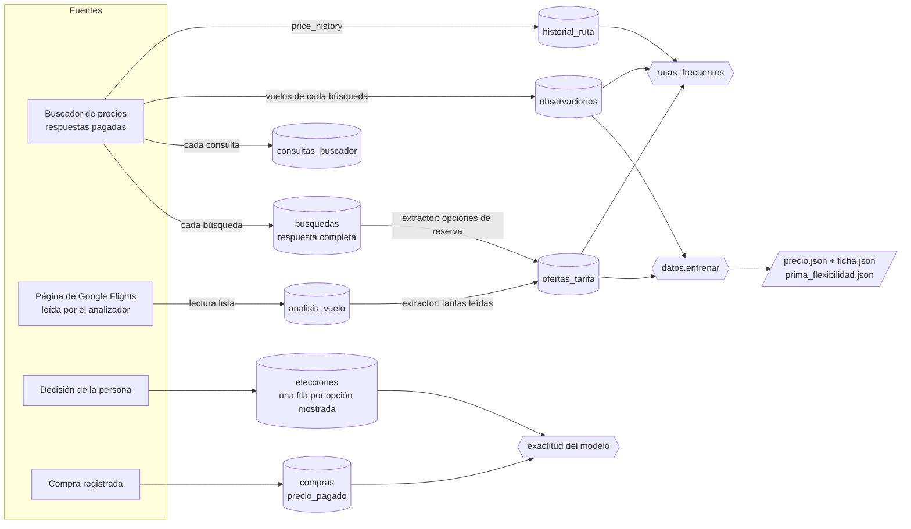

# Datos para modelos de precio y métricas de rutas frecuentes

Toda la información de vuelos que pasa por la plataforma queda en tablas consultables. Con ellas se entrena el modelo de precio esperado, se calculan las métricas de las rutas frecuentes y, más adelante, un modelo de decisión. Este documento dice qué tabla se llena, cuándo y con qué, cómo se limpia, cómo se entrena y qué se puede predecir hoy.

Dos principios:

- **Nada se pierde.** Las tablas solo reciben filas nuevas. Cada fila dice de dónde salió (`origen_fila`, `busqueda_clave`, `analisis_id`) y `ofertas_tarifa.crudo` guarda la tarifa tal como llegó, así que una normalización mejor se puede rehacer sin volver a buscar ni a pagar.
- **La limpieza es al cargar, no al guardar.** Lo que no sirve para entrenar se descarta al leer (`ofertas.depurar`) y se cuenta por motivo; la ficha del modelo guarda ese conteo.

### Cómo se garantiza que no se pierde nada

| Riesgo | Garantía |
|---|---|
| La misma tarifa vista en dos momentos | Cada respuesta guardada en `busquedas` es un origen propio (`busqueda:<id>`): la misma clave guardada otro día da otras filas |
| Una opción sin precio o con una forma desconocida | Se guarda igual, con `precio` vacío o entera en el crudo; la limpieza la deja fuera al entrenar («sin precio») |
| Dos opciones iguales del mismo vendedor o boletos separados | `ordinal` (posición en la respuesta) y `tramo` (`ida_vuelta`, `ida`, `regreso`) forman parte del índice único |
| Texto de Google que no se entiende | La línea queda en `sin_reconocer` y la fila en `normalizacion = parcial`; `tarifa_normalizada` queda vacía en vez de adivinar |
| El pedido de reserva dentro de una respuesta antigua | El crudo pasa por la misma limpieza que las respuestas guardadas: nunca lleva `booking_request` |
| Una respuesta o lectura sin tarifas | Queda en `ofertas_origenes` con `tarifas = 0`: se sabe que se leyó y no se vuelve a leer |
| Dos extracciones a la vez | Una transacción con cerrojo consultivo (PostgreSQL); la segunda sale como `ocupado` y no cuenta filas ajenas |
| La bitácora falla | Las filas ya quedaron confirmadas; el evento «tarifas extraídas» lo firma el extractor |

## Qué tabla se llena, cuándo y con qué

| Tabla | Cuándo se llena | Con qué |
|---|---|---|
| `busquedas` | Cada respuesta del buscador que se paga | La respuesta completa, sin el pedido de reserva |
| `consultas_buscador` | Cada consulta (en vivo, guardada o fallida) | Tipo, origen del dato, clave de la respuesta, cotización y quién |
| `observaciones` | Cada búsqueda de vuelos | Un vuelo por fila: ruta, aerolínea, escalas, duración, hora, anticipación, precio y rango típico |
| `historial_ruta` | Cada búsqueda de vuelos | Precio más bajo de cada día de los 60 anteriores |
| `analisis_vuelo` | Cada lectura de la página de Google Flights | Tarifas, vendedores, equipaje, cambios y reembolso tal como se leen |
| `ofertas_tarifa` | Al extraer (`python -m datos.ofertas`, el tablero de KPI cada 10 minutos o antes de entrenar) | Una fila por tarifa vista, normalizada |
| `elecciones` | Cada decisión | Cada opción mostrada con su precio, el costo esperado y los rasgos, entre ellos la diferencia frente al precio esperado |
| `compras` | Cada compra registrada | Precio pagado, cotizado y anticipación |

Las tablas `analisis_vuelo` y `compras` las crea el frente del analizador y de compras. Todo lo de aquí funciona sin ellas: si no existen, se omiten.

## Diccionario de `ofertas_tarifa`

Solo se añaden filas. Índice único por (`fuente`, `origen_fila`, `ordinal`, `tramo`, `vuelos`, `vendedor`, `tarifa`), declarado con la tabla: extraer dos veces no duplica. Índices por ruta y fecha de ida. RLS activado y sin permisos para los roles públicos. El registro `ofertas_origenes` (también con RLS) guarda cada respuesta o lectura ya extraída, cuántas tarifas dio y cuántas entraron; cada corrida procesa como mucho 200 y deja el resto para la siguiente.

| Columna | Qué es |
|---|---|
| `momento` | Cuándo se vio el precio (hora de la respuesta del buscador o de la lectura) |
| `fuente` | `buscador` o `pagina` |
| `origen_fila` | `busqueda:<id de busquedas>`, `archivo:<nombre>` (respaldo local, solo si la tabla no tiene esa clave) o `analisis:<id>`: de qué respuesta o lectura sale |
| `solicitud_id`, `opcion_id`, `analisis_id`, `busqueda_clave` | Cotización, opción de vuelo, lectura y respuesta de origen, cuando se conocen |
| `origen`, `destino`, `ida`, `regreso` | Aeropuertos reales y fechas del viaje |
| `vuelos` | Números de vuelo de la ida, juntos y sin espacios, como en las claves de la plataforma (`AA1851`) |
| `aerolinea` | Aerolínea que opera |
| `vendedor`, `es_aerolinea` | Quién vende la tarifa y si es la propia aerolínea (1) o una agencia (0) |
| `tarifa` | Nombre original (`Basic Economy`) |
| `tarifa_normalizada` | `basica`, `estandar`, `flexible` o `premium`: primero por el nombre; si no lo dice, por sus condiciones (reembolso total = flexible; sin cambios = básica). Vacía si no se reconoce |
| `precio`, `moneda` | Precio total del viaje para un adulto |
| `equipaje_mano` | 1 incluido, 0 con cargo o sin él, vacío si no se informa |
| `maleta_usd` | Primera maleta facturada en USD; 0 si va incluida; vacía si no está incluida y no dice el precio. Solo cuenta la línea de la primera maleta |
| `cambios` | `gratis`, `cargo` o `no` |
| `reembolso` | `total`, `parcial` o `no` |
| `asiento` | `incluido` o `cargo` |
| `anticipacion_dias`, `dia_semana`, `noches` | Días entre que se vio y la ida, día de la semana de la ida (0 = lunes) y noches del viaje |
| `ordinal`, `tramo` | Posición de la opción en su respuesta o lectura (desde 0) y qué cubre: `ida_vuelta`, o solo `ida` o `regreso` con boletos separados |
| `sin_reconocer` | JSON con las líneas de equipaje, cambios, reembolso o asiento que no se pudieron clasificar, y la tarifa sin tipo; vacío si se entendió todo |
| `normalizacion` | `completa` si se entendió todo lo que vino; `parcial` si algo quedó en `sin_reconocer` |
| `crudo` | La tarifa tal como llegó, en JSON, sin el pedido de reserva |

El texto de Google se lee en inglés (la página se pide siempre en inglés y en dólares): «1st checked bag: $110», «1st checked bag free», «Checked bag not included», «Free change, possible fare difference», «Free ticket changes», «No ticket changes», «No refunds», «Nonrefundable», «Full refunds», «Seat selection for a fee», «Seat selection: $25»… «not included», «no» y «0 bags» se leen antes que «free» o «included». Una reconfirmación (el precio al decidir) toma sus fechas y su ruta de los vuelos elegidos. Las pruebas de `tests/test_ofertas.py` recorren cada caso.

## Limpieza al cargar

`ofertas.depurar` descarta y cuenta, sin tocar la base:

| Motivo | Regla |
|---|---|
| sin precio | Precio vacío, cero o negativo |
| otra moneda | Moneda distinta de USD |
| sin ruta o fecha | Falta origen, destino o fecha de ida |
| anticipación imposible | Visto después de la ida o más de 365 días antes |
| un solo tramo | Tarifa de solo ida o solo regreso (boletos separados): su precio no se compara con uno de ida y vuelta |
| repetida el mismo día | La misma tarifa (vendedor, vuelo, fechas, tramo) de la misma fuente, vista en otra respuesta o lectura del mismo día: queda la más reciente. Distingue la fuente: la misma tarifa en el buscador y en la página son dos datos. Dentro de una misma respuesta, dos ofertas iguales son dos ofertas |
| precio atípico | A más de 5 desviaciones (desviación absoluta mediana × 1,4826) de la mediana de su ruta y tipo de tarifa; solo con 5 precios o más en el grupo |

La misma limpieza se aplica a `observaciones` antes de entrenar (allí cada fila ya es única y el grupo de atípicos es la ruta).

## Cómo extraer, entrenar y recolectar

| Paso | Comando | Gasta búsquedas |
|---|---|---|
| Extraer tarifas vistas | `python -m datos.ofertas` | No: solo lee lo guardado |
| Entrenar | `python -m datos.entrenar` | No |
| Ver el plan del recolector | `python -m datos.recolectar --frecuentes --simular` | No |
| Recolectar rutas frecuentes | `RECOLECTOR=encendido python -m datos.recolectar --frecuentes` | Sí, hasta el tope del día |

**Entrenar.** Une `observaciones` (sin rasgos de tarifa) y `ofertas_tarifa` (con tipo de tarifa, aerolínea o agencia, maleta incluida y cambio gratis; XGBoost recibe vacíos donde no hay dato), valida con cinco pliegues dejando fuera búsquedas o lecturas completas y compara con la línea base (mediana de la ruta). La ficha guarda versión, fecha, filas por fuente, rasgos, categorías, métricas frente a la línea base, importancia y el conteo de la limpieza. La regla de uso no cambia: el precio esperado se muestra solo con 200 filas o más y si supera la línea base. **Si el modelo nuevo no mejora el error del vigente, `precio.json` no se reemplaza**: el nuevo queda en `precio_candidato.json` y `ficha_candidata.json` para revisarlo. El entrenamiento escribe también `prima_flexibilidad.json`: la prima esperada por ruta y una general (`modelo.prima_esperada`).

**Recolectar.** `--frecuentes` toma las 5 rutas con más cotizaciones y viajes de los últimos 90 días (las de `rutas_frecuentes.top`), con anticipaciones de 7, 21, 45 y 75 días y 3 noches, salta lo ya guardado y se detiene en el tope diario `recoleccion_busquedas_dia` (regla editable en Reglas y supuestos, 10 por omisión). Cada búsqueda deja el evento «búsqueda recolectada». El interruptor `RECOLECTOR` está en `apagado` por omisión (en `app/config.py` y en el secreto de la nube); apagado no gasta nada.

**Programación diaria (documentada, sin desplegar).** Dos caminos equivalentes; cualquiera se enciende solo cuando se decida el presupuesto de búsquedas:

- Tarea programada en la nube (EventBridge Scheduler) que invoque una vez al día, a las 06:00 hora de Bogotá, la misma imagen con `python -m datos.recolectar --frecuentes` y `RECOLECTOR=encendido`.
- Flujo F7 de n8n: disparador diario → ejecutar el comando en el equipo o contenedor que tenga la conexión a la base → avisar por correo o Telegram cuántas búsquedas se gastaron.

**Costo.** Con el tope de 10, unas 300 búsquedas al mes. Con un plan de 250 búsquedas mensuales no alcanza: habría que bajar el tope a 6 u 8 (180 a 240 al mes) o ampliar el plan. El KPI `cupo_usado` avisa al pasar del 70 %.

## Qué se puede predecir hoy y qué falta

**Hoy.** Un precio esperado por vuelo con error medio de 116 USD (36 %) frente a 143 USD (49 %) de la línea base, con 760 vuelos de 42 búsquedas, todos capturados el mismo día (EXPLORACION.md, 9.1). Sirve como señal («este vuelo está caro para su ruta»), no como precio exacto, y no entra en el costo total. Las cifras de rutas frecuentes son descriptivas.

**Falta.**

- **Volumen**: decenas de tarifas vistas por ruta y tipo de tarifa para que la prima de flexibilidad y la comparación aerolínea o agencia sean estables. Hoy hay unas pocas lecturas.
- **Serie de tiempo propia**: capturar las mismas rutas en días distintos. Solo así se separa «faltan 7 días» de «sale un miércoles» y se puede decir cuándo comprar. Es lo que aporta el recolector diario.
- **Precio pagado**: con `compras.precio_pagado` el indicador de exactitud deja de medir solo contra el buscador.
- **Precio esperado en `elecciones`**: hoy cada opción guarda la diferencia en % frente al esperado (`frente_esperado`); el esperado se reconstruye desde el precio (error de medio punto como mucho). Guardar `esperado` en los rasgos lo haría exacto.

## Usos

1. **Presupuesto esperado al cotizar**: el precio esperado y su rango por ruta y anticipación para fijar el presupuesto del viaje antes de tener tarifas reales.
2. **Mejor anticipación de compra**: la mediana por tramo de anticipación de cada ruta frecuente dice desde cuántos días antes deja de bajar el precio; con serie propia, cuándo comprar.
3. **Valor de pagar flexibilidad**: la prima de flexibilidad esperada frente a la probabilidad de cambio de la cotización alimenta el costo total esperado: si prima < probabilidad de cambio × costo de cambiar, conviene la tarifa flexible.
4. **Modelo de decisión con `elecciones`**: cada opción mostrada con sus rasgos y la marca de cuál se eligió es un conjunto etiquetado para aprender qué valoran las personas además del precio.

## Indicadores y pantalla

- KPI `exactitud_modelo` (MAPE del precio esperado, meta ≤ 15 %, rojo > 30 %): ver `docs/kpis.md`.
- Sección «Rutas frecuentes y precios» en `/kpis` y `GET /api/v1/kpis/rutas-frecuentes` (`contracts/api-v1.md`): mediana por anticipación (0–7, 8–21, 22–45 y 46 días o más), volatilidad, tendencia del historial, prima de flexibilidad, aerolínea frente a agencia, una señal orientativa («por debajo / dentro / por encima» del rango habitual, sin prometer el futuro) y la exactitud por ruta y por mes. Con pocos datos, la pantalla avisa que las cifras son demostrativas.
