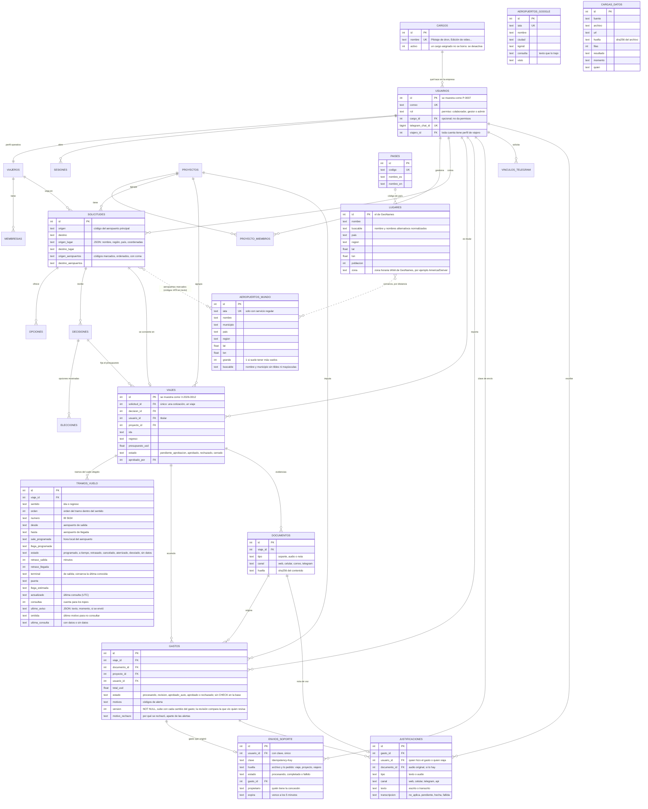

# Modelo de datos y regla de negocio

La base es relacional (PostgreSQL en la nube, SQLite en local, con el mismo código). El eje es el **viaje**: une la cotización con los gastos.

La regla de negocio completa (estados, permisos, motivos de revisión, umbrales) está en [`regla-de-negocio.md`](regla-de-negocio.md). Aquí está el modelo de datos y dónde la hace cumplir la base. Los atributos de las tablas que el diagrama no detalla están en el [informe técnico](informe-tecnico.md), sección 3.

```
persona ──► cotización ──► decisión ──► VIAJE ──► gastos y evidencias
                                          ▲
                                 aprobación de administración
```

## Diagrama entidad-relación



`tramos_vuelo` se llena al decidir (los tramos de ida y de regreso de la opción elegida) y guarda el último estado conocido del vuelo para el monitoreo; `envios_soporte` solo la usa el servidor. Ambas tienen seguridad por filas y sin permisos para los roles públicos, como el resto.

Tablas de registro, sin claves foráneas a propósito (un hecho se conserva aunque cambie lo demás): `eventos`, `errores`, `llamadas_modelo`, `telegram_mensajes`, `busquedas`, `observaciones`, `historial_ruta`, `consultas_buscador` y `cargas_datos`.

Datos de referencia del buscador mundial: `aeropuertos_mundo`, `lugares` y `paises` se cargan de los archivos de `datos/geografia/` (OurAirports y GeoNames, ver el README) y no tienen claves foráneas: un viaje guarda los códigos y el lugar elegido como texto, de modo que sigue siendo legible aunque los datos se actualicen. `aeropuertos_google` guarda los aeropuertos que solo conoce el autocompletado de Google, para poder elegirlos aunque no estén en los datos locales. `cargas_datos` deja una fila por archivo en cada carga, también si no cambió nada.

`consultas_buscador` guarda además las consultas de autocompletado con `tipo = 'autocompletado'` (la respuesta completa queda en `busquedas`, con clave `autocompletado_<texto>`). Solo las que gastaron una búsqueda (`en vivo` o `fallida`) cuentan contra los topes; las servidas de lo guardado no se registran porque serían una por pulsación.

## Identificadores

| Qué | Cómo se ve | De dónde sale |
|---|---|---|
| Persona | `P-0007` | Identificador de la fila en `usuarios` |
| Viaje | `V-2026-0012` | Año de creación e identificador de la fila en `viajes` |

Se calculan a partir de la clave primaria, así que no pueden repetirse ni quedar desfasados.

## Reglas y dónde se hacen cumplir

| Regla | En la base | En el código |
|---|---|---|
| Una cotización produce un solo viaje | Índice único en `viajes.solicitud_id` | `viajes.crear_desde_decision` |
| El viaje pertenece a quien viaja | Clave foránea `viajes.usuario_id` | `viajes.titular_de` |
| El presupuesto es lo que se espera pagar: compras de la decisión más viáticos por día | — | `viajes.presupuesto_de` |
| Estados válidos del viaje | Restricción `ck_viajes_estado` | `viajes.TRANSICIONES` |
| Solo administración aprueba, rechaza, reabre o cierra | — | `viajes.cambiar_estado`, que comprueba `acceso.es_admin` |
| Con el presupuesto aprobado la decisión no cambia sin reabrir | — | `viajes.bloquea_decision` |
| Todo gasto pertenece a un viaje aprobado; si no, se guarda y va a revisión | Clave foránea `gastos.viaje_id` | `validacion.revisar`: `sin_viaje`, `viaje_no_aprobado`, `viaje_cerrado`, `fuera_del_viaje`, `presupuesto_superado`; una compra anterior al viaje (vuelo, hotel, carro, compras del proyecto) solo avisa con `compra_anticipada` |
| A qué viaje va un gasto | — | `viajes.resolver_para_gasto`: el indicado, el fijado, el que está en curso, el próximo aprobado |
| Permisos válidos: `colaborador`, `gestor`, `admin` | Restricción `ck_usuarios_rol` | `acceso.ROLES` |
| El cargo no da permisos; es opcional | `usuarios.cargo_id`, clave foránea a `cargos` | `acceso.asignar_cargo` |
| Nombre de cargo único; un cargo con personas asignadas no se borra, se desactiva | `cargos.nombre` único | `acceso.crear_cargo`, `acceso.cambiar_cargo` |
| Toda cuenta tiene perfil de viajero | `usuarios.viajero_id` | `acceso.crear_usuario`, `acceso.crear_perfil_viajero` |
| Nadie aprueba ni rechaza su propio presupuesto, ni revisa sus propios gastos; el intento queda en la bitácora. Reabrir y cerrar lo propio sí se permite | — | Viaje: `viajes.cambiar_estado`. Gasto: `viajes.revision_permitida`, llamada desde `revision.guardar`. Bitácora: `viajes.impedir_autoaprobacion` |
| El traslado por carretera suma al costo, a la hora límite y al presupuesto; a menos de `traslado_minimo_km` no se suma | — | `costo.traslado` |
| Un código de aeropuerto marcado debe existir en los datos locales o en `aeropuertos_google` | — | `geografia.aeropuertos_conocidos` |
| El autocompletado de Google respeta `tope_autocompletado_mes` y `tope_autocompletado_persona_dia` | — | `geografia._tope_alcanzado` |
| Cada carga de datos de referencia deja su registro | Tabla `cargas_datos` | `geografia` (carga desde `datos/geografia/`) |
| Los importes son decimales válidos: ni vacíos, ni NaN o infinito, ni cero o negativos (el total) | — | `dinero.py`, `validacion.revisar`: `importe_invalido`; `gastos._importes_guardables` no deja que uno inválido llegue a la base |
| La fecha del recibo es AAAA-MM-DD real; una posterior a hoy avisa pero no bloquea | — | `validacion.revisar`: `fecha_invalida`, `fecha_futura` (aviso) |
| El duplicado compara también la moneda | — | `validacion.revisar` |
| Registrar, asignar viaje y aprobar un gasto se hacen con el viaje bloqueado | `select … for update` en PostgreSQL; `BEGIN IMMEDIATE` en SQLite | `db.transaccion`, `db.bloquear_viaje` |
| Reenviar un recibo con la misma clave no crea otro gasto | Único `(usuario_id, clave)` en `envios_soporte` | `envios.registrar_envio`; la API acepta `Idempotency-Key` (409 si la clave ya se usó con otro archivo o viaje) |
| Un gasto guardado con una versión anterior no pisa un cambio ajeno | `gastos.version` | `revision.py`: `EDIT_CONFLICT` en la API, aviso en la web |
| Rechazar un gasto exige un motivo de 5 caracteres o más y se le avisa a la persona | `gastos.motivo_rechazo` | `revision.py`, `POST /api/v1/gastos/{id}/revision` |
| Un gasto atascado en «procesando» pasa a revisión | — | `envios.recuperar_si_atascado` (5 min) |
| Los tramos del vuelo se registran al decidir, sin duplicarse si se decide de nuevo | `tramos_vuelo.viaje_id` | `monitoreo_vuelos.registrar_tramos` |
| El estado del vuelo se consulta solo en su ventana y bajo topes por tramo, por sentido del viaje y por día | — | `monitoreo_vuelos.consultar` (reglas `monitoreo_*`) |
| Cada hora del vuelo se interpreta en la zona de su aeropuerto | `lugares.zona` (GeoNames) | `geografia.zona_horaria`, `monitoreo_vuelos.zona` |
| Un aviso al viajero no se repite por la misma información | `tramos_vuelo.ultimo_aviso` | `monitoreo_vuelos.aviso`, `_avisar` |
| Al aprobar se reconfirma el precio; si sube más que `tolerancia_precio_aprobacion` administración lo confirma | — | `viajes.cambiar_estado`, `precios.reconfirmar` |
| Un chat de Telegram, una cuenta | Índice único en `usuarios.telegram_chat_id` | `telegram.vincular` |
| Una entrega de Telegram se procesa una vez; si falló, se puede reprocesar sin duplicar el gasto | `telegram_mensajes.update_id` único | `telegram.procesar` |
| Nada apunta a algo que no existe | Claves foráneas en todo el núcleo | `datos/migracion.py` las crea y limpia referencias huérfanas |

## Quién ve qué

El permiso (`usuarios.rol`) decide qué se puede hacer. El cargo (`cargos`) dice qué hace la persona en la empresa, aparece en su ficha y en la analítica, y no cambia lo que ve ni lo que puede.

| Permiso | Ve | Puede |
|---|---|---|
| Colaborador (antes piloto) | Sus cotizaciones, viajes, gastos y evidencias | Cotizar, decidir sus viajes, cargar gastos (web, celular, Telegram) |
| Gestor de proyecto | Lo suyo y todo lo de los proyectos que gestiona | Lo mismo que el colaborador y, en los proyectos que gestiona, cotizar y decidir por otras personas (`cotizacion.puede_decidir`). No aprueba viajes ni revisa gastos, ni justifica gastos ajenos |
| Administrador | Todo | Aprobar presupuestos, revisar gastos, administrar cuentas y cargos, monitorear. No aprueba lo propio |

Todas las cuentas viajan: cotizan, reciben viajes a su nombre y reportan gastos.

## Migración

`python -m datos.semilla` crea lo que falte y ejecuta `datos/migracion.py`, que se puede repetir: lo que ya hizo no lo vuelve a hacer. Renombra el permiso antiguo (`piloto` pasa a `colaborador` con el cargo «Pilotaje de dron»), siembra los cinco cargos iniciales en una tabla vacía, crea el perfil de viajero de las cuentas que no lo tienen, crea los viajes de las decisiones que ya existían, enlaza **una sola vez** los gastos anteriores cuyo viaje es inequívoco (el único de su viajero y su proyecto) y cuya fecha cae dentro de él, sin tocar los que ya revisó una persona (sube su versión y deja el evento «enlazado a su viaje»; la marca «gastos anteriores enlazados a su viaje» de la bitácora impide repetirlo, así que un gasto que administración saca de su viaje no vuelve a entrar), vacía referencias huérfanas, añade claves foráneas, restricciones e índices, alinea las columnas obligatorias del modelo (`gastos.version`) con la base, activa la seguridad por filas y retira los permisos de los roles públicos. `python -m datos.comprobar_supabase` revisa, solo en lectura, que la base tenga las tablas y columnas que espera esta versión y qué pueden hacer los roles públicos.

La trazabilidad del flujo de gastos (quién puede cambiar qué, qué queda registrado y las brechas conocidas) está en [`trazabilidad.md`](trazabilidad.md).

## Telegram

1. Crear el bot con BotFather y poner su clave en `.env` como `TELEGRAM_BOT_TOKEN`.
2. `python -m datos.telegram_webhook --preparar` anota el nombre del bot y genera el secreto.
3. Publicar la plataforma con esas variables en el secreto de la nube.
4. `python -m datos.telegram_webhook https://<dirección-pública>` registra la entrada.
5. Cada persona abre «Mi cuenta» → «Vincular Telegram».

Sin esas variables el canal queda apagado y lo demás funciona igual.
