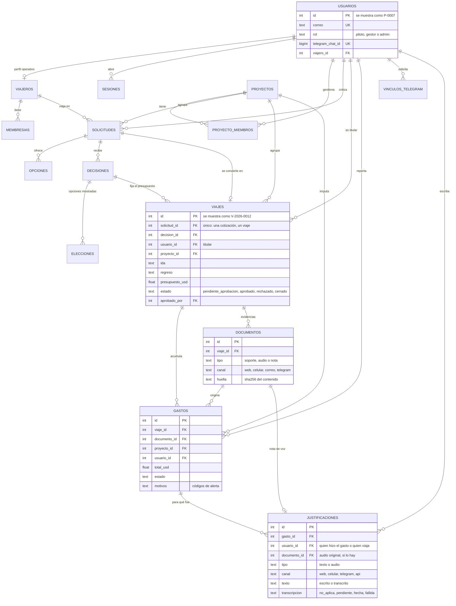

# Modelo de datos y regla de negocio

La base es relacional (PostgreSQL en la nube, SQLite en local, con el mismo código). El eje es el **viaje**: une la cotización con los gastos.

```
persona ──► cotización ──► decisión ──► VIAJE ──► gastos y evidencias
                                          ▲
                                 aprobación de administración
```

## Diagrama entidad-relación



Tablas de registro, sin claves foráneas a propósito (un hecho se conserva aunque cambie lo demás): `eventos`, `errores`, `llamadas_modelo`, `telegram_mensajes`, `busquedas`, `observaciones`, `historial_ruta`.

## Identificadores

| Qué | Cómo se ve | De dónde sale |
|---|---|---|
| Persona | `P-0007` | Identificador de la fila en `usuarios` |
| Viaje | `V-2026-0012` | Año de creación e identificador de la fila en `viajes` |

Se calculan a partir de la clave primaria, así que no pueden repetirse ni quedar desfasados.

## Reglas y dónde se hacen cumplir

| Regla | En la base | En el código |
|---|---|---|
| Una cotización produce un solo viaje | Índice único en `viajes.solicitud_id` | `viajes.crear_desde_decision` |
| El viaje pertenece a quien viaja | Clave foránea `viajes.usuario_id` | `viajes.titular_de` |
| El presupuesto es lo que se espera pagar: compras de la decisión más viáticos por día | — | `viajes.presupuesto_de` |
| Estados válidos del viaje | Restricción `ck_viajes_estado` | `viajes.TRANSICIONES` |
| Solo administración aprueba, rechaza, reabre o cierra | — | `viajes.cambiar_estado`, `acceso.nivel` |
| Con el presupuesto aprobado la decisión no cambia sin reabrir | — | `viajes.bloquea_decision` |
| Todo gasto pertenece a un viaje aprobado; si no, se guarda y va a revisión | Clave foránea `gastos.viaje_id` | `validacion.revisar`: `sin_viaje`, `viaje_no_aprobado`, `viaje_cerrado`, `fuera_del_viaje`, `presupuesto_superado` |
| A qué viaje va un gasto | — | `viajes.resolver_para_gasto`: el indicado, el fijado, el que está en curso, el próximo aprobado |
| Roles válidos | Restricción `ck_usuarios_rol` | `acceso.ROLES` |
| Un chat de Telegram, una cuenta | Índice único en `usuarios.telegram_chat_id` | `telegram.vincular` |
| Una entrega de Telegram se procesa una vez | `telegram_mensajes.update_id` único | `telegram.procesar` |
| Nada apunta a algo que no existe | Claves foráneas en todo el núcleo | `datos/migracion.py` las crea y limpia referencias huérfanas |

## Quién ve qué

| Rol | Ve | Puede |
|---|---|---|
| Piloto | Sus cotizaciones, viajes, gastos y evidencias | Cotizar, decidir sus viajes, cargar gastos (web, celular, Telegram) |
| Gestor de proyecto | Lo suyo y todo lo de los proyectos que gestiona | Lo mismo que el piloto sobre lo suyo; lo ajeno, solo lectura |
| Administrador | Todo | Aprobar presupuestos, revisar gastos, administrar cuentas, monitorear |

## Migración

`python -m datos.semilla` crea lo que falte y ejecuta `datos/migracion.py`, que se puede repetir sin efecto: renombra el rol antiguo, crea los viajes de las decisiones que ya existían, enlaza los gastos cuyo viaje es inequívoco, vacía referencias huérfanas, añade claves foráneas, restricciones e índices, activa la seguridad por filas y retira los permisos de los roles públicos.

## Telegram

1. Crear el bot con BotFather y poner su clave en `.env` como `TELEGRAM_BOT_TOKEN`.
2. `python -m datos.telegram_webhook --preparar` anota el nombre del bot y genera el secreto.
3. Publicar la plataforma con esas variables en el secreto de la nube.
4. `python -m datos.telegram_webhook https://<dirección-pública>` registra la entrada.
5. Cada persona abre «Mi cuenta» → «Vincular Telegram».

Sin esas variables el canal queda apagado y lo demás funciona igual.
