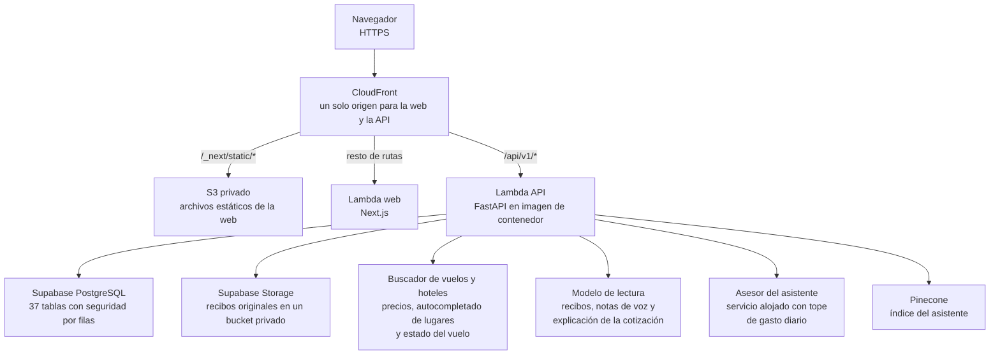
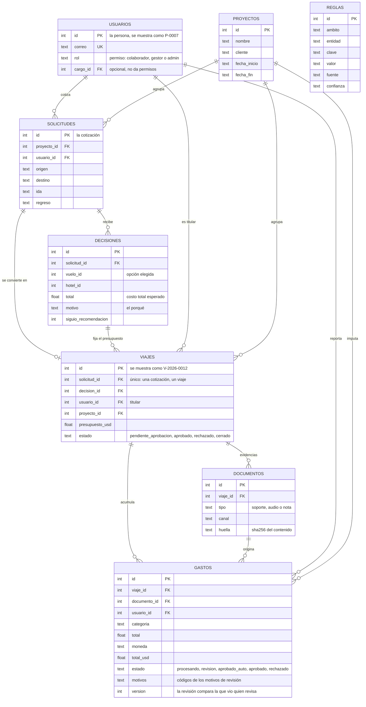
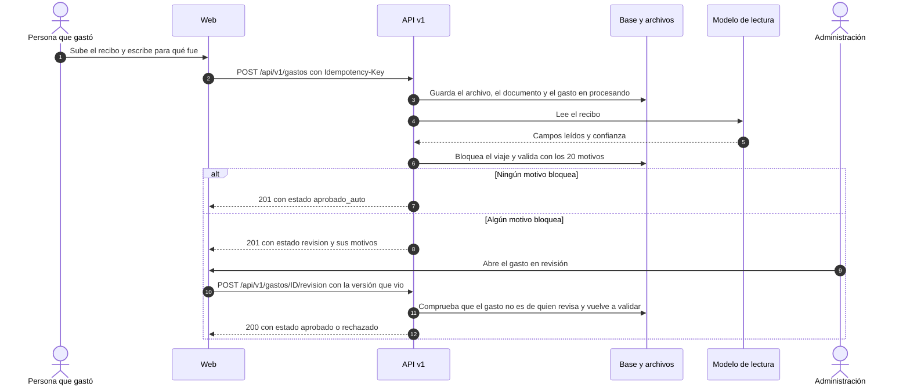

# Guía técnica

Documentación técnica simplificada de la plataforma de viajes de grabación y gastos: lo necesario para entender cómo está hecha en dos o tres páginas. El detalle de cada tema está en el [informe técnico](informe-tecnico.md); la regla de negocio, en [`regla-de-negocio.md`](regla-de-negocio.md); la explicación sin jerga, en la [presentación](presentacion.md).

## 1. Arquitectura publicada

Una API en FastAPI con la regla de negocio y una web en Next.js que solo habla con la API v1. Las dos se sirven desde el mismo origen (https://software.nataliaremolinarodriguez.com), detrás de CloudFront.

- **Infraestructura como código** (`infra/`, CDK), en tres pilas: `OperacionBase` (secreto de configuración y avisos por correo), `OperacionApp` (la función de la API y cinco alarmas) y `OperacionWeb` (la función de la web, los estáticos, CloudFront, el certificado y los registros DNS).
- **En local es la misma forma:** `make entorno-web` levanta PostgreSQL, la API, la web y un gateway que hace lo que CloudFront hace en producción. No lee `.env` ni necesita claves: usa respuestas reales guardadas del buscador y lecturas guardadas de los recibos de ejemplo.
- **Código:** `app/servicios/` tiene la regla de negocio por dominio (viajes, validación, costo, cotización, revisión); `app/rutas/v1_*.py`, la API v1, cuyo contrato está en [`contracts/api-v1.md`](../contracts/api-v1.md); `web/`, la web ([`web/README.md`](../web/README.md)).
- **Etapa de transición:** hoy es una aplicación y una base. La separación en servicios está diseñada y se hará por anillos, sin reescribir ([ADR 0001](adr/0001-arquitectura-objetivo.md)). Las pantallas anteriores que servía la API se retiran a medida que la web las cubre: con `INTERFAZ_ANTIGUA=redirige`, cada una lleva a su equivalente en la web (`app/servicios/interfaz.py`; apagado por omisión).

Detalle: [informe técnico, sección 2](informe-tecnico.md#2-arquitectura-actual-en-producción) y [`produccion.md`](produccion.md).

## 2. Modelo de datos esencial

El eje es el viaje: une la cotización (reto 1) con los gastos (reto 2). El diagrama muestra solo las tablas que cuentan esa historia; el modelo completo está en [`datos.md`](datos.md).

- **`reglas` no tiene relaciones a propósito:** guarda las reglas de aerolíneas y hoteles, los supuestos (valor de la milla, viáticos, tolerancias), las metas de los indicadores y las cuentas contables. Se edita en la pantalla *Reglas* y cada cambio queda en la bitácora.
- **Lo que hace cumplir la base:** una cotización produce un solo viaje (índice único en `viajes.solicitud_id`), los estados del viaje (`ck_viajes_estado`), los permisos (`ck_usuarios_rol`) y las claves foráneas. Los estados del gasto los hace cumplir el código.
- **La bitácora** (`eventos`) guarda cada paso del viaje y del gasto, con quién y cuándo, incluidos los intentos de aprobar lo propio.

## 3. La vida de un gasto

- **A qué viaje va:** al que la persona indica si es suyo; si no indica ninguno, al aprobado que está en curso o al próximo aprobado (`viajes.resolver_para_gasto`; el orden completo está en la [regla de negocio, sección 6](regla-de-negocio.md#6-a-qué-viaje-va-un-gasto)). Sin viaje, el gasto se guarda igual y va a revisión.
- **Reintentos sin duplicados:** la misma `Idempotency-Key` con el mismo archivo devuelve el mismo gasto; con otro archivo, 409. Un archivo idéntico ya leído no se vuelve a leer.
- **Nunca queda a medias:** si la lectura falla o no termina en 5 minutos, el gasto pasa a `revision` con el motivo `lectura_fallida`.
- **Concurrencia:** registrar, asignar viaje y aprobar se hacen con el viaje bloqueado, así que dos aprobaciones a la vez no gastan el mismo saldo. La revisión es versionada: si el gasto cambió mientras se revisaba, 409 `EDIT_CONFLICT`.
- **Revisión:** `guardar`, `aprobar`, `excepcion` (porqué de 8 caracteres o más) o `rechazar` (motivo de 5 o más). La regla es una sola (`app/servicios/revision.py`) para cualquier pantalla y para la API.

## 4. Seguridad

| Tema | Cómo está |
|---|---|
| Contraseñas e ingreso | Argon2id, mínimo 10 caracteres; espera progresiva desde el quinto fallo |
| Identidad | Token aleatorio en una cookie `HttpOnly`, `Secure` y `SameSite=Lax` (`__Host-` fuera de local); en la base solo se guarda su huella. Dura 12 horas, 2 de inactividad |
| Escrituras | Cada escritura de la API v1 exige `X-CSRF-Token` y un origen permitido (`ORIGENES_WEB`) |
| Permisos por registro | El alcance sale de quien ingresó, nunca del cuerpo de la petición; lo que no se puede ver responde 404 |
| Nadie aprueba lo suyo | En el servicio, para cualquier pantalla y para la API; cada intento queda en la bitácora |
| Base de datos | Seguridad por filas activa en todas las tablas y ningún permiso para los roles públicos de Supabase |
| Archivos | El tipo se decide por el contenido; máximo 4,5 MB; los originales van a un bucket privado |
| Secretos | Solo en Secrets Manager y en archivos `.env*` fuera de git; los ganchos de git rechazan secretos |
| Servicios de pago | Topes editables por persona y por día (cotizaciones, autocompletado, estado del vuelo, asistente, asesor) |

Detalle, datos que salen a terceros y pendientes: [informe técnico, sección 4](informe-tecnico.md#4-seguridad).

## 5. Pruebas

Cifras del [informe técnico, sección 5](informe-tecnico.md#5-pruebas-y-calidad), medidas el 13 de noviembre de 2026 sobre `bf33d50`:

| Conjunto | Orden | Resultado |
|---|---|---|
| Python (pytest, SQLite temporal y servicios simulados) | `.venv/bin/python -m pytest -q` | 893 pruebas en 52 archivos: 890 pasan y 3 se omiten (necesitan Docker) |
| Linter de Python | `.venv/bin/python -m ruff check .` | Sin hallazgos |
| Web (Vitest) | `cd web && npx vitest run` | 372 pruebas en 48 archivos, todas pasan |
| Infraestructura (pilas de CDK) | `cd infra && npm test` | 37 pruebas en 12 grupos, todas pasan |

Todas corren sin claves ni base real. La integración continua las ejecuta en cada envío a `main` o `dev` en cuatro trabajos: Python, web, infraestructura e imágenes. La exactitud de la lectura de recibos con modelo no tiene todavía una cifra medida ([`exactitud-lectura.md`](exactitud-lectura.md)).

## 6. Despliegue

| Paso | Qué se hace |
|---|---|
| 1. Respaldo | `make respaldar` y ensayo de restauración con `make verificar-respaldo` ([`respaldo.md`](respaldo.md)) |
| 2. Migración | Solo si cambia el esquema, por el puerto 5432; la base publicada nunca se migra al arrancar |
| 3. Secreto | Solo si cambian claves, con `infra/poblar_secreto.py`, que nunca muestra valores |
| 4. Revisión del cambio | `cdk diff` revisado antes de aplicarse |
| 5. Despliegue | Una pila a la vez: `OperacionBase`, `OperacionApp`, `OperacionWeb` |
| 6. Comprobaciones y vuelta atrás | Las de [`despliegue.md`](despliegue.md), con la vuelta atrás de cada parte |

Operación diaria, alarmas y costos: [`produccion.md`](produccion.md) y el [informe técnico, secciones 6 y 7](informe-tecnico.md#6-observabilidad).

## 7. Límites conocidos

Los más relevantes para quien lee el código: el dinero se guarda en coma flotante (las reglas validan con decimales exactos y la API lo entrega como cadenas); la distancia por carretera es una estimación; el estado del vuelo solo se probó con una respuesta de ejemplo; solo hay tasas de cambio para EUR y COP. La lista completa y la hoja de ruta están en el [informe técnico, secciones 9 y 10](informe-tecnico.md#9-limitaciones).
