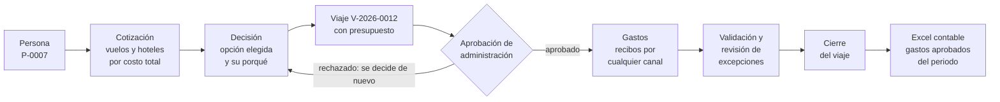
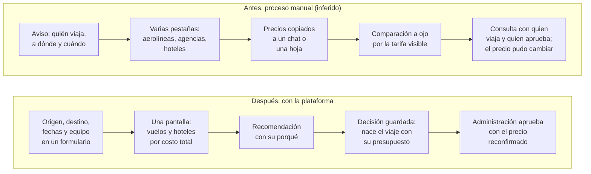
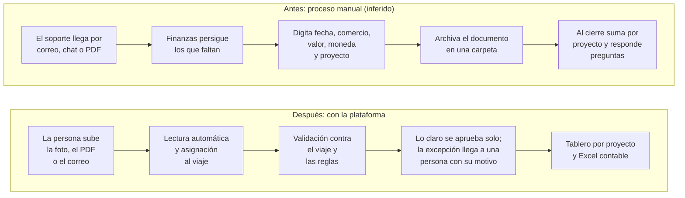
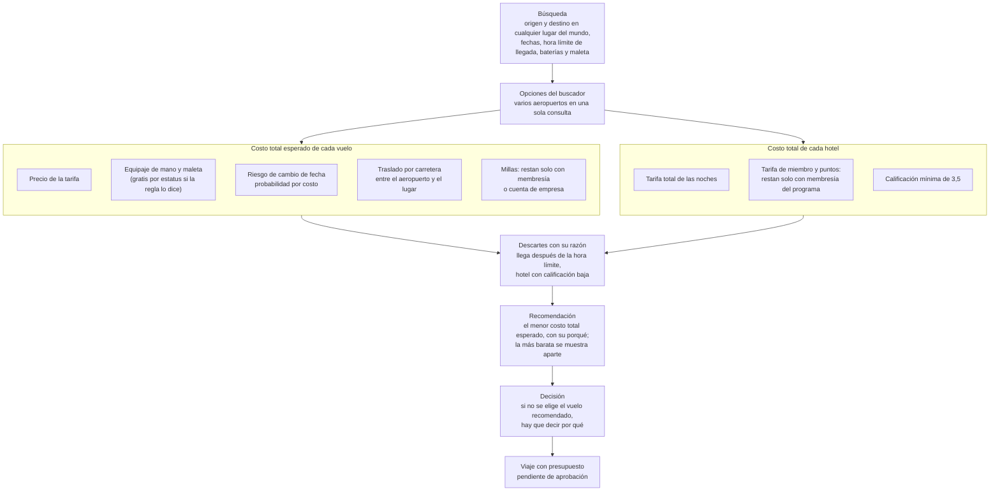
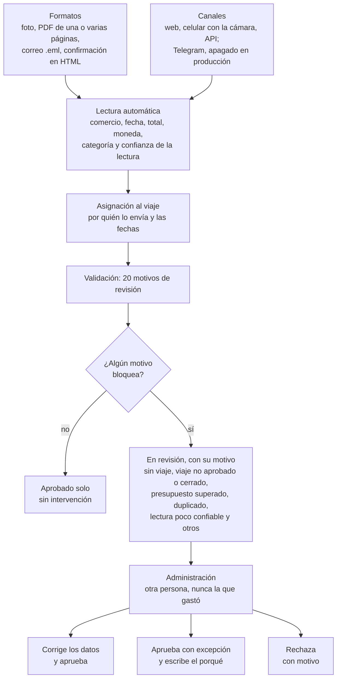
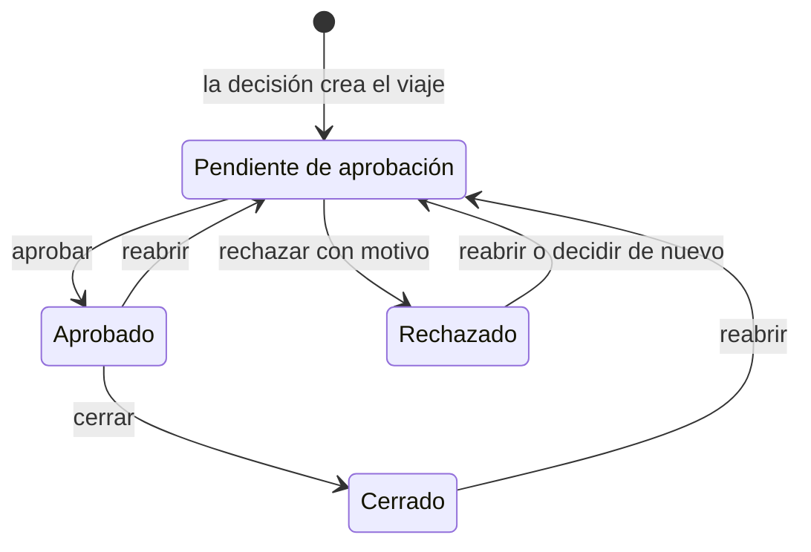
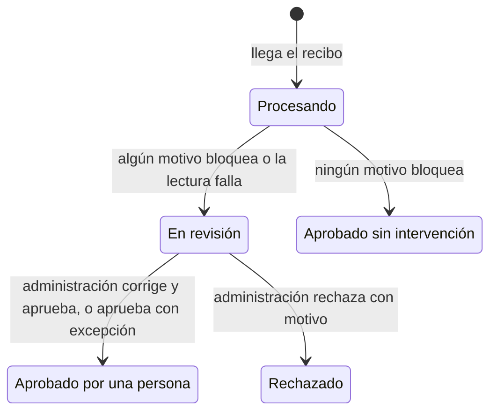
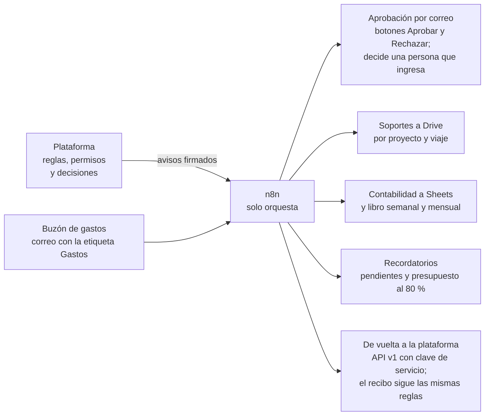

# Presentación: viajes de grabación y gastos en una sola plataforma

Documento para quien evalúa la prueba. Lectura de 5 a 8 minutos, sin jerga. El detalle técnico está en la [guía técnica](guia-tecnica.md) y la regla completa, en [`regla-de-negocio.md`](regla-de-negocio.md).

**Verla funcionando:** https://software.nataliaremolinarodriguez.com (recorrido de 5 minutos en la [sección 9](#9-cómo-verla-en-5-minutos)).

## 1. El problema

Una empresa de marketing inmobiliario graba propiedades con drones en Estados Unidos y Europa. Cada grabación obliga a alguien a viajar con equipo delicado (baterías, cámaras) a lugares que a veces no tienen aeropuerto principal. Eso deja dos trabajos repetidos, que la prueba plantea como dos retos:

| | Reto 1: cotizar el viaje | Reto 2: recoger los gastos |
|---|---|---|
| Qué se pide | Elegir vuelos y hoteles por su **costo total**, con los programas de fidelización, y decidir mejor en menos tiempo | Reunir recibos de distintos tipos, formatos y canales, organizarlos por proyecto y darles seguimiento sin trabajo manual |
| Dónde duele hoy | La tarifa más barata termina siendo la más cara (equipaje, cambio de fecha, traslado) y no queda registro de por qué se eligió | Alguien persigue soportes, los digita en una hoja de cálculo y pregunta a qué proyecto va cada uno |

El proceso manual de la empresa no se conoce: el que se describe aquí es una inferencia declarada en el análisis previo ([`ANALISIS.md`](../ANALISIS.md), secciones 2.1 y 3.1).

## 2. La idea central: el viaje como eje

Los dos retos describen el mismo objeto en dos momentos. El reto 1 decide **cuánto debería costar** un viaje; el reto 2 registra **cuánto costó**. Resueltos por separado quedarían dos listas que alguien concilia a mano. Por eso la plataforma es una sola y todo gira alrededor del viaje ([ADR 0003](adr/0003-el-viaje-como-eje.md)):

- La decisión de la cotización **crea el viaje** con su código y su presupuesto.
- Cada gasto **se asigna solo** al viaje de la persona (por quién lo envía y las fechas) y se valida contra ese presupuesto.
- El proyecto agrupa viajes y gastos: lo previsto y lo real se ven juntos, por viaje y por proyecto.

## 3. Antes y después

### Reto 1: cotizar

Trabajo que desaparece: abrir varios sitios y copiar precios, sumar a mano equipaje, traslado y riesgo de cambio, recordar las reglas de millas de cada aerolínea, y reconstruir después por qué se eligió una opción (queda guardado con la decisión).

### Reto 2: gastos

Trabajo que desaparece: digitar cada recibo, preguntar a qué proyecto pertenece, buscar duplicados a ojo, convertir monedas y rehacer el consolidado para contabilidad. Finanzas revisa excepciones, no cada dato.

## 4. Reto 1 en un diagrama: de la búsqueda al costo total

- **No gana el precio más bajo, gana el costo total esperado.** En el escenario Miami → Moab (un pueblo sin aeropuerto principal) se comparan tres aeropuertos con su traslado por carretera, y la opción recomendada no es la más barata.
- **Fidelización sin inventar ahorros.** Las millas y los puntos solo restan si la persona o la empresa tienen membresía; si no, la plataforma muestra la oportunidad de inscribirse.
- **Cada cifra dice de dónde sale:** del buscador (en vivo o guardado), de una regla o de un supuesto editable.

## 5. Reto 2 en un diagrama: del recibo a la aprobación

- **Contra el viaje:** el gasto debe pertenecer a un viaje con presupuesto aprobado, caer en sus fechas (con un día de margen antes y dos después) y no pasar del presupuesto más una tolerancia del 10 %.
- **Contra las reglas:** total que no cuadra, campos que faltan, duplicado exacto o aproximado, importe atípico, moneda sin tasa de cambio, lectura con confianza menor de 0,85.
- De los 20 motivos, **17 bloquean y 3 solo avisan** (fecha posterior a hoy, compra anticipada y hotel reservado por agencia, que pierde los puntos). La lista completa está en [`regla-de-negocio.md`](regla-de-negocio.md#4-validación-de-los-gastos-motivos-de-revisión).

## 6. Estados y quién hace qué

**El viaje**

**El gasto**

| | Colaborador | Gestor de proyecto | Administración |
|---|---|---|---|
| Ve | Lo suyo | Lo suyo y los proyectos que gestiona | Todo |
| Cotiza y decide | Sus viajes | Los suyos y, en sus proyectos, los de otras personas | Para cualquier persona |
| Carga y justifica gastos | Los suyos | Los suyos | Los suyos, y carga recibos a nombre de otra persona |
| Aprueba viajes y revisa gastos | No | No | Sí, **salvo los propios** |
| Descarga el Excel contable | De lo suyo | De sus proyectos | De todo |

**Nadie aprueba lo suyo.** El presupuesto del viaje y los gastos de una persona de administración los aprueba o revisa otra cuenta de administración. La regla vive en el servicio, no en la pantalla: el intento se impide y queda en la bitácora. Todos los permisos viajan; el cargo (pilotaje, edición, desarrollo…) es un dato aparte que no da permisos.

## 7. Qué mejora la automatización

| Paso manual que se evita | Control automático que lo reemplaza | Indicador que lo mide |
|---|---|---|
| Comparar a mano aeropuertos, hoteles, equipaje y millas | Costo total esperado de cada opción y recomendación con su porqué | Ahorro identificado y capturado; horas de la cotización a la decisión |
| Perseguir la aprobación del presupuesto | Viaje pendiente en la lista de administración, con el precio reconfirmado (si sube más del 5 %, se confirma el precio nuevo) | Horas de la decisión a la aprobación |
| Digitar cada recibo | Lectura automática de foto, PDF, correo y HTML | Campos corregidos sobre campos leídos; costo de leer un recibo |
| Preguntar a qué proyecto va un gasto | Asignación al viaje por quién lo envía y las fechas | Gastos sin viaje |
| Revisar todos los recibos | Aprobación sin intervención de lo claro; solo las excepciones llegan a una persona, con su motivo | Gastos aprobados sin intervención; horas de la carga a la aprobación |
| Vigilar el presupuesto con una hoja aparte | Cada gasto se valida contra el presupuesto del viaje, con el viaje bloqueado para que dos aprobaciones no gasten el mismo saldo | Gasto aprobado sobre presupuesto; viajes sobre presupuesto |
| Armar el consolidado para contabilidad | Excel contable con cuenta por categoría y resumen por proyecto | — |

Son 21 indicadores con meta y semáforo (11 del reto 1 y 10 del reto 2, en [`kpis.md`](kpis.md)); con pocos datos muestran el método, no conclusiones.

**Tiempo que ahorra (supuesto declarado).** No hay una medición del proceso manual. Como referencia, comparar a mano un viaje toma unos 45 minutos y transcribir, clasificar y asignar un recibo, unos 5. Las dos cifras son supuestos, no mediciones; lo real lo miden los indicadores a medida que haya uso.

### El siguiente escalón: automatizaciones con n8n (propuesta)

**Diseñado, sin construir.** La plataforma sigue validando, decidiendo y guardando; n8n solo orquesta: recibe avisos firmados y llama a la API con una clave de permisos acotados. Ninguna automatización aprueba ni rechaza por su cuenta ([`n8n/automatizaciones.md`](n8n/automatizaciones.md)).

## 8. Qué es real, qué es simulado y qué es supuesto

| Real | Simulado | Supuesto (editable y rotulado) |
|---|---|---|
| Cuentas y permisos | Personas, clientes, comercios y membresías de ejemplo («Dato de ejemplo») | Valor de la milla y del punto de hotel, tarifa de miembro, viáticos por día, probabilidad de cambio de fecha |
| Precios en vivo del buscador de vuelos y hoteles; sin clave, respuestas reales guardadas | Los 13 recibos de prueba, sellados «FICTICIO · prueba técnica» | Distancia y tiempo por carretera (línea recta por un factor) |
| Lectura de recibos y notas de voz con modelo de lenguaje | El buzón de correo: un `.eml` o `.html` se sube a mano | Cuentas contables de cada categoría, que contabilidad debe confirmar |
| Base de datos, almacenamiento y despliegue en la nube con dominio propio | El estado del vuelo de la demostración («Estado de ejemplo») | Reglas de aerolíneas de fuentes secundarias (la pantalla *Reglas* muestra fuente y confianza) |
| Asistente con fuentes citadas | Telegram: probado con un bot simulado y apagado en producción | Metas de los indicadores y tiempo ahorrado |

La exactitud de la lectura con modelo todavía no tiene una cifra medida: el medidor existe y está pendiente de corrida ([`exactitud-lectura.md`](exactitud-lectura.md)).

## 9. Cómo verla en 5 minutos

En https://software.nataliaremolinarodriguez.com, con una cuenta de colaborador y otra de administración. En producción no existen las cuentas de demostración: las crea administración. Sin cuenta, el mismo recorrido funciona en local y sin claves con `make instalar` y `make ejecutar`, con las cuentas del [README](../README.md#cuentas-de-demostración); allí la búsqueda usa respuestas guardadas, así que conviene seguir los aeropuertos exactos de su [guía de demostración](../README.md#guía-de-demostración-en-local-con-docker).

1. **Cotizar** (colaborador): origen Miami, destino Moab, del 8 al 11 de diciembre de 2026 → *Buscar y comparar*. La recomendada no es la más barata; el desglose muestra el traslado por carretera.
2. **Decidir:** elegir una opción y *Guardar decisión*. Nace el viaje `V-…`, pendiente de aprobación.
3. **Aprobar** (administración): *Viajes* → *Por aprobar* → aprobar. Para ver que nadie aprueba lo suyo: cotizar y decidir un viaje con la cuenta de administración e intentar aprobarlo; la plataforma lo impide.
4. **Cargar un recibo** (colaborador): *Gastos* → *Cargar recibo*, con un archivo de `datos/ejemplos/`. Los claros se aprueban solos; el borroso queda en revisión.
5. **Revisar** (administración): *Gastos* → abrir el que está en revisión: «Por qué va a revisión», aprobar o rechazar con motivo.
6. **Excel contable:** *Gastos* → «Excel contable».

## 10. Hoja de ruta resumida

1. **Operar con garantías:** despliegue con aprobación, respaldo nocturno, medición de la exactitud de la lectura, Telegram con el bot de producción.
2. **Cerrar huecos del MVP:** monitoreo del vuelo con tarea programada, pantalla de membresías, más monedas, compras del proyecto sin viaje.
3. **Automatizaciones con n8n:** en el orden de la propuesta (avisos y soportes a Drive, decisión desde el correo, buzón de gastos, solicitud de viaje por correo).
4. **Arquitectura objetivo:** separar por servicios sin reescribir, por anillos ([ADR 0001](adr/0001-arquitectura-objetivo.md)).

El detalle y las limitaciones conocidas están en el [informe técnico](informe-tecnico.md#10-hoja-de-ruta).

## Publicado / En publicación

Lista que se ajusta al integrar cada pantalla de la web.

| Publicado | En publicación |
|---|---|
| Ingreso | Proyectos |
| Cotizar: buscar, comparar y decidir | Usuarios |
| Viajes: los propios y, para administración, por aprobar con la reconfirmación del precio | Mi cuenta |
| Gastos: cargar recibo, justificación, lista y detalle | Revisión completa de un gasto (corregir los datos leídos y aprobar con excepción) |
| Revisión de gastos: aprobar o rechazar con motivo | Reglas |
| Excel contable | KPIs |
| Resumen de administración | Monitoreo |
| Asistente | Estado de los vuelos |
